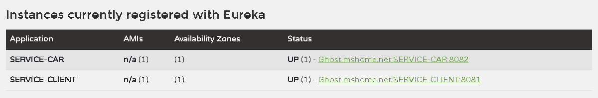
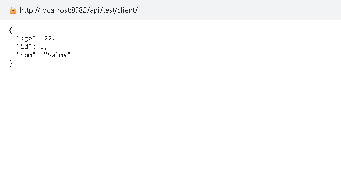
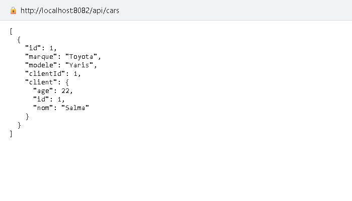

# TP 21 : Architecture Micro-services avec WebClient

Architecture composée de 3 projets Spring Boot :

| Projet | Port | Rôle |
|---|---|---|
| `eureka-server` | 8761 | Service discovery Eureka |
| `service-client` | 8081 | Microservice Client (MySQL `clientservicedb`) |
| `service-car` | 8082 | Microservice Voiture (MySQL `carservicedb`) + appel de `SERVICE-CLIENT` par son nom Eureka via WebClient `@LoadBalanced` |

Ordre de lancement : MySQL → `eureka-server` → `service-client` → `service-car`.

## Résultats

### 1. Tableau de bord Eureka
SERVICE-CLIENT et SERVICE-CAR sont enregistrés et au statut UP dans Eureka.

### 2. Test WebClient
`GET http://localhost:8082/api/test/client/1` : service-car récupère le client depuis service-client via WebClient, en utilisant l'URL logique `http://SERVICE-CLIENT/...`.

### 3. Voitures enrichies
`GET http://localhost:8082/api/cars` renvoie la voiture lue dans la base locale, enrichie avec les informations de son client.

